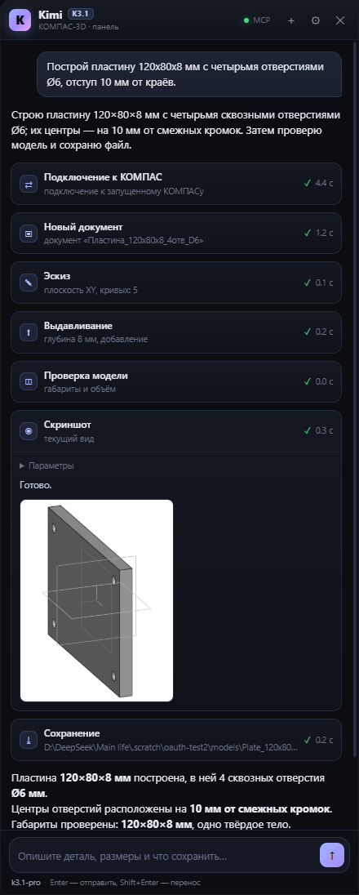
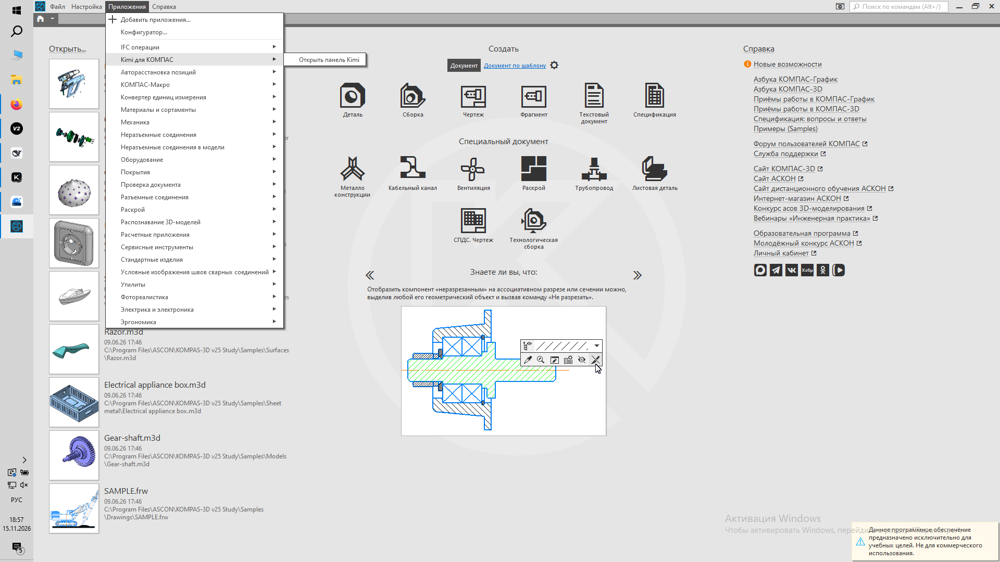

# Kimi для КОМПАС-3D

Панель чата с Kimi K3.1, пристёгнутая к окну КОМПАС-3D v25. Агент строит детали
по текстовому описанию через MCP-мост к API КОМПАС, проверяет модель, сохраняет
`.m3d` и показывает скриншот.

Репозиторий: [github.com/Iophinie/Compas-3D-Kimi-3.1](https://github.com/Iophinie/Compas-3D-Kimi-3.1)



## Что проверено

- Реальный Kimi K3.1 построил пластину 120×80×8 мм с четырьмя отверстиями Ø6
  (центры в 10 мм от кромок): объём 75 895,22 мм³, одно тело, файл `.m3d` сохранён,
  скриншот вернулся в чат.
- Агент сам вызывает `connect`, `create_part`, `create_sketch`, `extrude`,
  `inspect_model`, `save_model`, `model_preview`.
- Проверены панель, закрепление за окном КОМПАС, настройки, сохранение ключа,
  запуск через `run.cmd` и `run.vbs`, установка `install.ps1`.
- Пункт меню **«Приложения → Kimi для КОМПАС → Открыть панель Kimi»** появляется
  после установки и запускает панель.

## Что нужно

- Windows 10/11 x64.
- КОМПАС-3D v25 с установленным компонентом «Средства разработки приложений» (SDK).
- Подписка Kimi с включённым Kimi Code (тариф Plus или выше).
- Python 3.12 и [uv](https://docs.astral.sh/uv/) в `PATH`.
- Microsoft Edge WebView2 Runtime (обычно уже установлен в Windows 11).

## Установка

Подробная пошаговая инструкция — в [INSTALL.md](INSTALL.md).

1. Скачайте папку проекта целиком.
2. Откройте PowerShell в папке проекта и выполните:

   ```powershell
   powershell -NoProfile -ExecutionPolicy Bypass -File .\install.ps1
   ```

   Скрипт создаст `.venv`, поставит зависимости, подготовит MCP-сервер КОМПАС,
   соберёт `host\KompasChatPanel.exe`, зарегистрирует пункт меню в КОМПАСе
   и положит ярлык на рабочий стол.

3. Перезапустите КОМПАС-3D.

## Открыть из КОМПАСа

В меню **«Приложения»** выберите **«Kimi для КОМПАС»** → **«Открыть панель Kimi»**.
Панель запустится и пристегнётся к окну КОМПАСа. Отдельный ярлык тоже работает,
но теперь он не обязателен.



Пункт меню ставится в `HKCU\Software\ASCON\KOMPAS-3D\AddIns\KimiKompas`
(файл `host\KimiKompas.rtw`, `AutoConnect=1`), права администратора не нужны.
Если КОМПАС был открыт во время установки — перезапустите его.

### Если окно не появилось

- Закройте все процессы `KompasChatPanel.exe` в диспетчере задач: старый зависший
  экземпляр может перехватить запуск.
- Перезапустите КОМПАС и снова выберите пункт меню.
- Нажмите `Ctrl+Alt+K` — панель могла быть скрыта.
- Если не помогло, запустите `run-console.cmd` и посмотрите
  `%APPDATA%\KompasChat\logs\app.log` и `host\panel.log`.

## Первый запуск

1. Панель появится у правого края окна КОМПАС.
2. Нажмите ⚙ и выберите способ входа — можно использовать любой:
   - **API-ключ:** вставьте ключ из [Kimi Code Console](https://www.kimi.com/code/console)
     в поле «Ключ Kimi Code» и нажмите «Проверить ключ».
   - **Вход через Kimi Code:** нажмите «Войти через Kimi Code», откройте страницу
     Kimi и подтвердите код.
3. Ключ и токены сессии хранятся в `%APPDATA%\KompasChat\config.json` и шифруются
   Windows (DPAPI).
4. Напишите задачу, например:

   > Построй пластину 120×80×8 мм с четырьмя сквозными отверстиями Ø6 мм,
   > центры в 12 мм от краёв. Сохрани и покажи.

Агент сам вызовет `connect`, `create_part`, `create_sketch`, `extrude`,
`inspect_model`, `save_model`, `model_preview` и вернёт путь к файлу и картинку.

## Управление

| Действие | Как |
|---|---|
| Показать/скрыть панель | `Ctrl+Alt+K` |
| Отправить | `Enter` |
| Перенос строки | `Shift+Enter` |
| Новый диалог | `+` в шапке |
| Настройки | ⚙ в шапке |
| Закрыть панель | ✕ в шапке |

Панель закреплена за окном КОМПАС: следует за перемещением и разворачиванием,
прячется вместе с ним, не занимает место на панели задач.

## Как это устроено

```
Kimi Code (подписка)
      │  Anthropic Messages API
      ▼
панель Kimi  ──►  MCP (stdio)  ──►  kompas3d-mcp  ──►  COM API КОМПАС
```

- `app/server.py` — локальный FastAPI-сервер, поток событий NDJSON.
- `app/agent.py` — цикл агента: текст → tool_use → MCP → tool_result → ответ.
- `app/kimi.py` — клиент Kimi через Anthropic SDK (`https://api.kimi.ai/coding/`).
- `app/kimi_oauth.py` — вход через Kimi Code (device code), refresh токена.
- `app/mcp_bridge.py` — stdio-клиент MCP, запускает `kompas3d-mcp`.
- `vendor/kompas3d-mcp` — открытый MCP-сервер КОМПАС (MIT), 41 инструмент.
- `host/Panel.cs` — WinForms + WebView2, frameless-окно, закреплённое за КОМПАС.
- `host/KimiKompas.rtw` — нативная библиотека КОМПАС для пункта меню.
- `kompas-rtw/` — исходники этой библиотеки (`LIBRARYENTRY`, меню-ресурс).
- `web/` — интерфейс чата.

## Настройки

Файл: `%APPDATA%\KompasChat\config.json`.

| Параметр | По умолчанию | Смысл |
|---|---|---|
| `model` | `k3.1-pro` | Модель Kimi Code |
| `base_url` | `https://api.kimi.ai/coding/` | Anthropic-совместимый endpoint |
| `tool_mode` | `core` | 18 инструментов моделирования вместо 41 |
| `panel_width` | `440` | Ширина панели, px |
| `save_dir` | `Documents\KompasChat` | Куда сохранять модели |
| `mcp_command` | `vendor\...\.venv\Scripts\python.exe` | Python MCP-сервера |
| `mcp_args` | `["-m","kompas_mcp.server"]` | Аргументы запуска |

## Ограничения первой версии

- Строятся **детали по тексту**. Чертежи по модели, чтение PDF/сканов и сборки —
  следующий этап; MCP-инструменты для них уже есть.
- Качество 3D-построений зависит от модели и от того, насколько полно заданы размеры.
  Всегда проверяйте дерево построения, размеры и массу в КОМПАСе.
- Скриншоты и изображения из инструментов уходят в облако Kimi. Не используйте
  панель для материалов с ограничениями по передаче, если это не согласовано.
- Панель не является официальным продуктом АСКОН или Moonshot AI.

## Разработка

```powershell
# сервер без окна
.venv\Scripts\python.exe -m app --no-panel --port 8801

# тестовый агент без ключа Kimi
$env:KOMPAS_CHAT_MOCK = "1"
.venv\Scripts\python.exe -m app --no-panel --port 8801

# пересобрать окно
powershell -NoProfile -ExecutionPolicy Bypass -File .\build_host.ps1

# пересобрать пункт меню КОМПАС (нужен Visual Studio C++)
powershell -NoProfile -ExecutionPolicy Bypass -File .\build_rtw.ps1
```

## Лицензии

- Код панели — MIT.
- `vendor/kompas3d-mcp` — MIT, см. `vendor/kompas3d-mcp/LICENSE`.
- КОМПАС-3D и его SDK — собственность АСКОН; условия использования определяются
  вашей лицензией.
- Kimi — сервис Moonshot AI; условия определяются подпиской.
